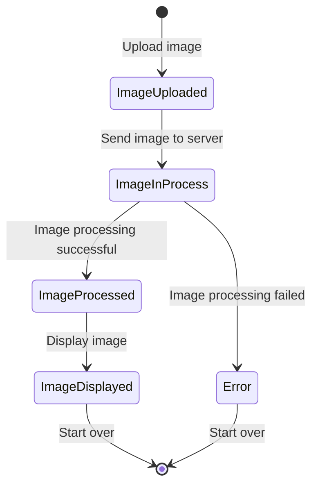
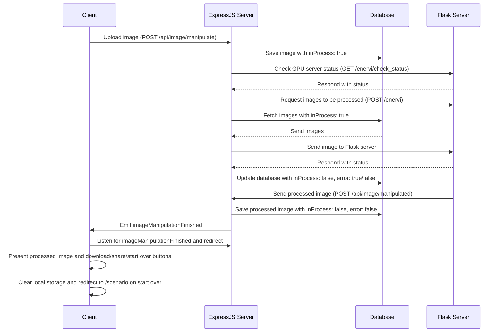
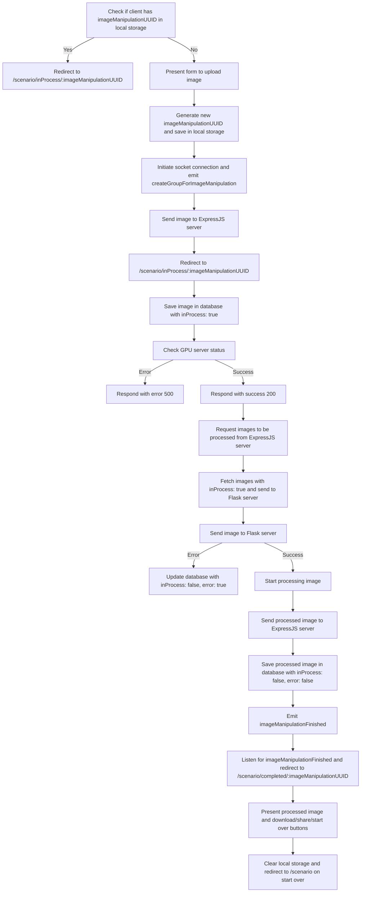
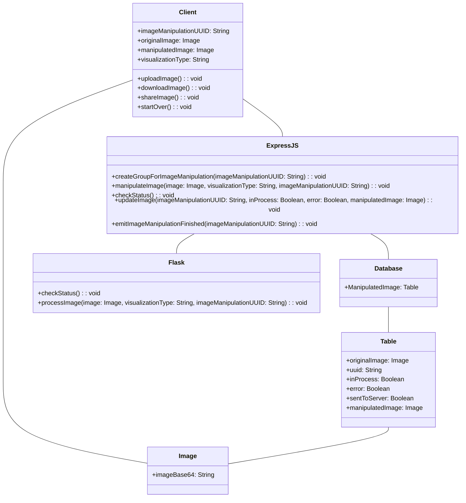

# enervi image manipulation

## Route: "/scenario"

- Check if the client has a local storage with a imageManipulationUUID
- If the client has a local storage with a imageManipulationUUID, client redirects to `/scenario/inProcess/:imageManipulationUUID`

- If not, then the client will be presented with a form to upload an image with a particular scenario.

- A new imageManipulationUUID is generated and saved in the local storage.
- A socket connection is initiated with the server and "createGroupForImageManipulation" event is emitted with the imageManipulationUUID

```javascript
socket.emit("createGroupForImageManipulation", imageManipulationUUID);
```

- The image is sent to the ExpressJS server

```javascript
POST "/api/image/manipulate"
{
    originalImage: imageBase64,
    visualizationType: string,
    imageManipulationUUID: string,
}
```

- On success, the client then redirects to `/scenario/inProcess/:imageManipulationUUID`

- The ExpressJS server saves the image in the database table "ManipulatedImage" with the imageManipulationUUID. The image is saved with the following properties:

```javascript
ManipulatedImage.create({
    originalImage: imageBase64,
    uuid: imageManipulationUUID,
    inProcess: true,
    sentToServer: false,
    error: false,
});
```

- The ExpressJS server checks GPU server status by making a GET request to the Flask server

```javascript
GET "{GPU_SERVER_URL}/enervi/check_status"
```

- On error, the ExpressJS server responds with an error 500
- On success, the ExpressJS server responds with a success 200

```javascript
ManipulatedImage.updateMany(
  { uuid: pendingImage.uuid },
  { sentToServer: true }
);
```

- After the GPU check_status is successful, the Flask server makes a POST request to the ExpressJS server to request the images to be processed

- The ExpressJS server on receiving the request, fetches all the images from the database table "ManipulatedImage" with inProcess as true and sentToServer as false and sends them one by one to the Flask server

- In case there are no pending images, the flow ends here

```javascript
POST "{STARTUP_SERVER_URL}"
{
    image: imageBase64,
    visualizationType: string,
    imageManipulationUUID: string,
}
```

- The Flask server responds with success 200 and starts processing the image
- If an error occurs, the Flask server responds with an error 500 and the ExpressJS updates the database table "ManipulatedImage"

```javascript
ManipulatedImage.findOneAndUpdate(
  { uuid: imageManipulationUUID },
  { inProcess: false, sentToServer: true, error: true }
);
```

- Once the image is processed, the Flask server sends the processed image to the ExpressJS server

```javascript
POST "/api/image/manipulated"
{
    image: imageBase64,
    imageManipulationUUID: string,
}
```

- The ExpressJS server saves the processed image in the database table "ManipulatedImage" with the imageManipulationUUID

```javascript
ManipulatedImage.findOneAndUpdate(
    { uuid: imageManipulationUUID },
    { inProcess: false, error: false, manipulatedImage: imageBase64 }
);
```

- The ExpressJS server initiates a socket event "imageManipulationFinished"

```javascript
eventEmitter.emit("imageManipulationFinished", imageManipulationUUID);
```

- On the client side, the client listens for the socket event "imageManipulationFinished" and redirects to "/scenario/completed/:imageManipulationUUID"

```javascript
socket.on("imageManipulationFinished", (imageManipulationUUID) => {
  navigate("/scenario/completed/" + imageManipulationUUID);
});
```

## Route: "/scenario/inProcess/:imageManipulationUUID"

- The client will be presented with a loading screen and a message "Your image is being processed"
- The client listens for the socket event "imageManipulationFinished" and redirects to "/scenario/completed/:imageManipulationUUID"
- On refresh, the client makes an API call to the ExpressJS server to check if the image is processed

```javascript
GET "/api/image/manipulated/:imageManipulationUUID"
```

- If inProcess is false, and error is false, the client redirects to "/scenario/completed/:imageManipulationUUID"

## Route: "/scenario/completed/:imageManipulationUUID"

- The client will be presented with the processed image and a button to download and a button to share the image; along with a button to start over
- The start over button will clear the local storage and redirect to "/scenario"

## Diagram

### State Diagram



### Sequence Diagram



### Flowchart



### Class Diagram


